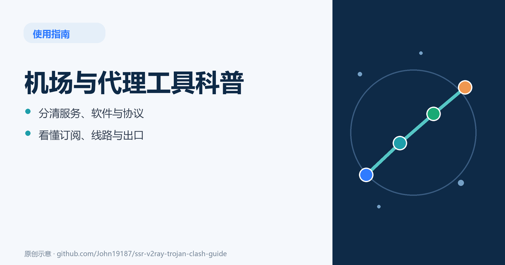
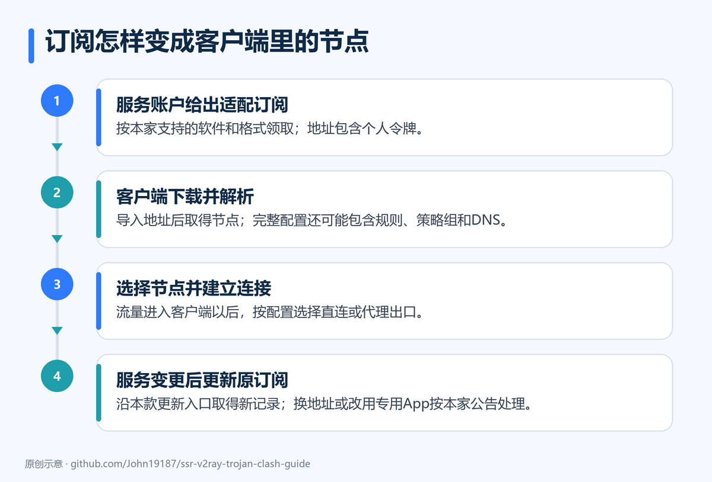
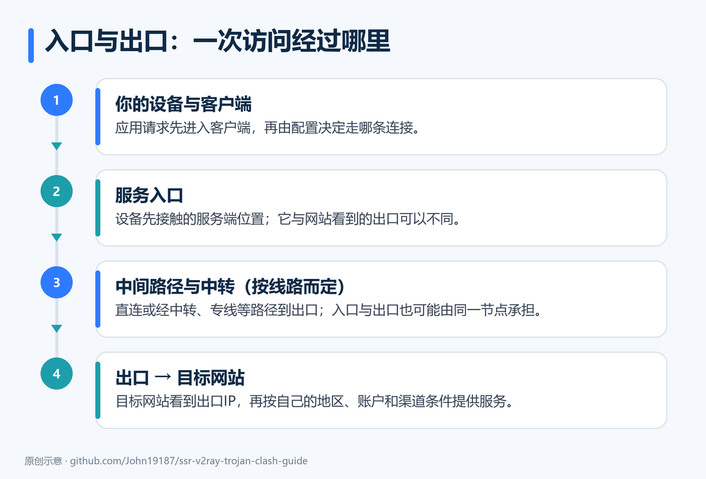
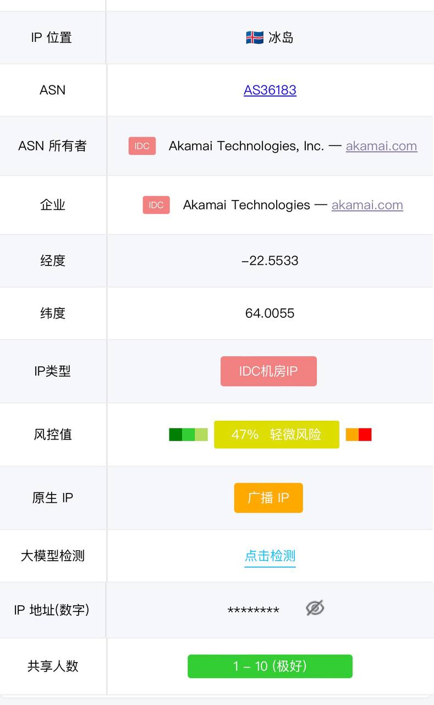
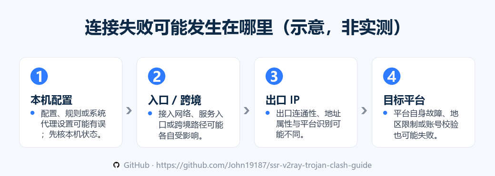

# 2026年机场与代理工具科普指南：协议、客户端、订阅和线路

机场提供连接服务，客户端把服务用在你的设备上，协议规定两端怎样通信。理解这三者的分工，比记住一串软件名更有用：买了客户端，还需要连接资料；取得订阅以后，还要选对能读取它的软件；服务入口调整时，处理的是节点更新，而不是一遍遍重装App。

**刚接触这些名词：** 从[服务与软件](#layers)读起。**已有订阅：** 查看[订阅、节点和配置](#subscription)。**正在断联：** 直接看[按现象处理连接问题](#diagnosis)。[2026年环境变化摘要](#network-context)按时间说明资源调整、客户端变化与恢复进展；本家通知调整接入方式时，再按[维护与迁移的判断方法](#service-changes)处理。

## 机场、VPN服务和客户端，各自提供什么

日常所说的“机场”，通常是出售代理节点、流量套餐和订阅的服务方。它负责服务器、节点和相应的接入资源。你在账户里取得连接资料，再交给设备上的客户端使用。

有些服务把账户、套餐、节点选择和连接开关都放进自己的App。另一些服务提供通用订阅，让你使用FlClash、Clash Verge Rev、Shadowrocket等软件。两种交付方式各有适用条件：前者要看服务支持哪些系统；后者还要看订阅格式、协议和客户端兼容性。某些服务对专属App和第三方客户端提供的线路不同，选购时就要确认。

| 名称 | 负责什么 | 你实际会拿到什么 |
|---|---|---|
| 机场或节点服务 | 提供服务器连接、节点与套餐权益 | 服务账户、个人订阅或本家App的登录方式 |
| 成套VPN服务 | 将账户、连接服务和软件一起交付 | 本家App、可选地区及设备使用条件 |
| 通用客户端 | 读取兼容资料，选择节点并处理本机流量 | 安装在手机、电脑或路由器上的软件 |
| 协议 | 约定客户端和服务器如何通信 | 节点记录中的协议类型及相应参数 |
| 代理内核 | 实现协议、连接、路由和DNS等功能 | 软件内部负责连接的程序，或单独运行的核心程序 |
| 订阅或配置 | 把节点、策略及规则交给软件 | 一条个人地址或一份文件，内容随服务和格式不同 |

购买Shadowrocket或Loon，取得的是软件使用权。要使用机场服务，还需要一份该软件支持的节点或订阅。只收到服务账号和密码的人，应先看本家是否提供通用订阅；账号登录入口和订阅地址有不同用途。

“VPN”也有几种常见用法。在技术上，[WireGuard](https://www.wireguard.com/)、OpenVPN、IKEv2/IPsec等可以用来建立加密隧道；在商品页里，它也常被用作一类连接服务的名称。手机上的代理App还会使用系统的VPN接口接管流量，因此状态栏出现VPN图标，先说明软件启用了相应接口。节点究竟用Trojan、Shadowsocks还是其他协议，要看节点和配置本身。

## 协议、内核和软件，为什么总是混在一起

一个名称可能指通信协议，也可能指支持多种协议的程序。把它们放回各自的位置，就能理解为什么“换成VLESS”和“换成Clash Verge Rev”是两种不同的调整。

### Shadowsocks、SSR与SS2022

[Shadowsocks](https://shadowsocks.org/doc/what-is-shadowsocks.html)是一套代理协议与实现：本地程序接收请求，加密后发给远端，远端再访问目标并把结果送回。SS是它常见的简称。ShadowsocksR通常简称SSR，是另一套在Shadowsocks基础上发展出的协议与实现，节点参数和支持软件应分别确认。

SS2022指Shadowsocks的AEAD-2022方案，仍属于Shadowsocks协议体系。服务提供的加密方法、密码和客户端实现要相互匹配；旧软件认识“SS”这个名字，也可能读不了新方案。具体导入入口以服务账户为准，格式问题可查[订阅格式与导入错误专题](https://github.com/John19187/proxy-client-guides/blob/main/subscription-formats.md)。

### VMess、VLESS，以及TLS和REALITY

VMess、VLESS是代理协议名称。[V2Ray](https://www.v2fly.org/)是支持多种入站和出站协议的程序项目；Xray也是多协议代理程序。节点协议是其中一层，程序负责把这些协议实现出来。

数据在网络上传送时，还会用到TCP或UDP。TCP处理数据顺序和丢失后的重传，让两端能连续交换数据；UDP按一份份数据报发送，应用需要可靠传送时，可以再安排相应的确认与重传。QUIC建立在UDP之上，又提供连接、加密和有序数据流等能力。它们与节点所用的代理协议处在不同层次。

一条节点记录里还可能出现TCP、WebSocket、gRPC、TLS或REALITY。这些字段承担的作用不同：有的描述传输或承载方式，有的描述连接的安全机制。[Xray传输文档](https://xtls.github.io/config/transport.html)将传输方式和传输安全分别配置。因此，“VLESS＋REALITY”是一组连接条件，不是一款App的名字。

同理，[v2rayN电脑客户端](https://github.com/John19187/proxy-client-guides/blob/main/downloads/v2rayn/README.md)和[v2rayNG安卓客户端](https://github.com/John19187/proxy-client-guides/blob/main/downloads/v2rayng/README.md)是两个不同的软件，界面、配置管理和升级步骤各自维护。名称相似不等于备份文件可以互换。

### Trojan怎样使用TLS

[Trojan协议](https://trojan-gfw.github.io/trojan/protocol)先建立真实的TLS连接，再在其中发送认证与代理请求。使用时，服务器地址、端口、密码、证书和域名配置都要对应。证书校验帮助客户端确认连接的是预期服务器，遇到证书错误时应查域名、证书或服务公告，保留校验设置。

TLS保护连接内容，服务器IP、端口和部分握手信息仍属于另一层信息。普通TLS中的SNI用来说明要访问的域名；后文会介绍它与ECH的关系。理解这些层次，比把Trojan简单叫作“完全看不见的HTTPS”更准确。

### Hysteria 2、TUIC和AnyTLS

[Hysteria 2](https://v2.hysteria.network/)使用定制的QUIC协议，[TUIC](https://sing-box.sagernet.org/configuration/outbound/tuic/)也使用QUIC。它们与基于TCP的连接可能受到不同的网络条件影响；选择之前，先确认服务提供了对应节点，当前接入网及客户端支持所需方式。

[AnyTLS](https://github.com/anytls/anytls-go)着眼于TLS代理中的握手特征、分包填充和连接复用。AnyTLS是协议，anytls-go是其参考实现，日常用户通常通过支持它的客户端使用服务给出的节点。

协议升级也可能需要客户端或内核升级。服务换了节点类型以后，软件能否识别这份配置才是兼容性的直接问题；安装了新软件，并不会自动把仍在使用的旧订阅改成服务要求的新内容。

### Clash、Mihomo、sing-box和图形客户端

Clash经常同时出现在内核、配置格式和软件名称里。现在的Clash类客户端可能使用Mihomo等内核，并提供导入、节点选择、规则和系统代理界面。Clash Verge Rev、FlClash、Clash Mi属于具体软件；它们各自管理配置和平台功能，不能只凭“同为Clash类”就交换全部设置。

sing-box既可以作为核心程序运行，也有相应平台客户端。它的原生JSON配置与Clash类YAML配置不是同一份结构。服务账户若分别提供两种入口，就选目标软件对应的那项；软件标注“支持某协议”和“能读取某种完整配置”也要分开看。

iPhone、iPad用户常见[Shadowrocket](https://github.com/John19187/proxy-client-guides/blob/main/downloads/shadowrocket/README.md)、[Loon](https://github.com/John19187/proxy-client-guides/blob/main/downloads/loon/README.md)、[Stash](https://github.com/John19187/proxy-client-guides/blob/main/downloads/stash/README.md)等软件；电脑和Android也各有选择。先按设备和手里的资料选软件，完整平台对照在[2026年机场通用客户端汇总与下载教程](https://github.com/John19187/proxy-client-guides#choose)，下载和操作则进入相应二级页。

服务明确要求自己的App时，先按本家说明使用。[Nextin专用客户端说明](https://github.com/John19187/proxy-client-guides/blob/main/downloads/provider-app/README.md)列出了这款软件已取得资料的适用条件，其他品牌App按各自说明使用。

### 系统代理、TUN和分流规则

客户端运行以后，应用的流量还要进入它，才会按配置处理。系统代理把代理设置交给支持它的应用使用；有些App有自己的网络设置，因此浏览器能用时，其他App仍可能表现不同。

TUN通过系统里的虚拟网络接口接收流量，再交客户端处理，实际接管范围由系统与软件设置共同决定。进入客户端以后，分流规则再决定哪些请求直连、哪些经代理组或节点发送。接管方式与分流规则负责不同问题；具体选择见[系统代理与TUN的区别](https://github.com/John19187/proxy-client-guides#proxy-tun)，Rev自己的操作与恢复再看相应专题。

## 订阅、节点和完整配置，怎样相互配合

节点是一条连接记录，里面可能包含服务器、端口、协议和认证参数。一个服务可以给你多个节点，节点名称常用地区或线路作标记。列表里写“香港”，通常是在描述服务所标注的节点或出口；实际路径仍要结合本家的线路说明。

订阅地址用于下载一批节点或配置，并取得后续变化。它通常与个人账户绑定，应像密码一样保管，不公开发到群里、截图或陌生转换网站。服务更换节点以后，更新原订阅可能取得新记录；如果本家要求换订阅地址或迁入专属App，就按那次公告处理。

完整配置还可能包含代理组、分流规则和DNS设置。导入完整配置与添加几条节点，可能改变的内容不同。自己写过规则的人，覆盖前先保留原配置；只需要更新节点时，沿客户端的订阅更新入口完成即可。

图中把服务交付、客户端解析与连接分开；导入成功以后，仍要选好节点并让应用流量进入客户端。

限时下载也是一种交付条件。有的账户要先开启下载窗口，或只允许在特定App里取配置。订阅地址下载失败时，先查账户公告与对应格式；已保存节点能否继续连接，则由原入口是否仍在提供服务决定。保住现有可用配置，可以减少迁移时的损失。

## 直连、中转、专线和出口，怎样影响实际使用

一次访问会经过本机软件、服务入口、跨境路径、出口，再到目标网站。入口是设备先接触的服务端位置，出口是目标网站看到的来源地址。出口显示同一地区的两个节点，中间路径可以不同；节点名称里的地区也不负责说明全部路径。

直连通常指设备直接连接相应的境外服务节点。中转是在中间再经过服务器或资源。IPLC、IEPL常出现在跨境专线产品和机场套餐描述中，选购时要看它具体覆盖哪些节点、套餐和接入条件。线路标签之外，本地运营商、入口拥挤程度、出口质量和晚间负载都会影响体验。

示意图按访问顺序说明各环节。中间路径随线路变化，入口和出口也可能是同一台服务节点；目标网站最终看到的是出口地址。

低延迟有利于交互，带宽影响持续传输；游戏还涉及丢包、抖动以及游戏服务器本身的路由。网页能打开、视频能播放和游戏好用，是不同使用目标。选节点时用自己的实际任务确认，别只追求列表里的最低延迟。

### 流量、倍率、付款周期和设备限制

| 套餐项目 | 实际要弄清的内容 |
|---|---|
| 月付、季付、年付 | 每次付款对应多久，流量何时重置，套餐何时到期 |
| 按量或流量包 | 流量有没有期限，是否还有设备、速度或最低消费条件 |
| 节点倍率 | 传输量怎样扣除；明确按3倍计算的节点，传输10GB会计为30GB |
| 带宽上限 | 适用于账户、设备、节点还是某种使用条件 |
| 设备数与同时在线 | 允许登记多少设备，与能同时连接多少设备分别确认 |
| 自有App与通用订阅 | 哪些套餐、平台和节点能用，是否支持路由器与自定义规则 |
| 试用与退款 | 领取方式、时限、用量、购买渠道及退款限制 |

免费资源的取得方式、来源和时点，应与收费服务分开理解。[免费节点与订阅资源](https://github.com/John19187/v2ray-SSR-Clash-Verge-Shadowrocke)提供的是该页实际收录内容；付费服务则还涉及账户、套餐和维护安排。价位本身无法告诉你具体包含哪些条件，先比较自己的设备、流量和使用方式。

需要看具体服务时，可读[VPN推荐：App、设备和使用条件](https://github.com/John19187/The-40-Best-VPNs)，以及[机场推荐：月付、按量套餐与线路选购](https://github.com/John19187/ji-chang-tui-jian)。两篇都是同作者维护的推荐与推广文章，具体服务与套餐事实在各自正文更新。

## 加密以后，为什么还会出现网络限制

加密保护的是通信中的内容，连接仍然经过服务器地址、端口和网络路径，流量也有握手、长度与传输时序等特征。不同限制可以作用于不同位置：域名解析、握手中的域名信息、特定IP或端口，以及某种流量特征。

[GFW Report全加密流量研究](https://gfw.report/publications/usenixsecurity23/zh/)发表于2023年，研究2021年11月起的现象及2022年的测量，描述了对Shadowsocks、VMess等全加密流量的被动识别。论文中的系统使用协议指纹和数据特征等启发式规则作判断。这里的识别针对流量特征，理解它不需要把加密想象成已经失去作用。

HTTP Host、TLS SNI和QUIC连接中的相关信息，又属于不同机制。2025年发表的[QUIC研究](https://gfw.report/publications/usenixsecurity25/en/)记录了2024年4月7日起出现的特定域名过滤，其中国测点为北京、广州、上海的7个腾讯云或阿里云测点。TCP与UDP可能有不同结果，所以某次TCP超时而UDP仍可用，值得作为具体网络现象记录。

地域也会改变结果。[河南地区研究](https://gfw.report/publications/sp25/en/)的核心证据来自郑州联通AS4837，观测期为2023年11月至2025年3月，中间2024年3至10月缺测。对照网络和测量日期，是理解这类研究的必要部分。

### DNS、SNI和ECH解决的是哪一层

DNS把域名解析成访问所需的地址。TLS握手中的SNI用于告诉服务器要访问的域名，ECH尝试加密其中的ClientHello信息；客户端还需要取得相应的加密配置。于是，取得配置的DNS路径与后面的加密握手，是两个相连的环节。

[2025年ECH研究](https://petsymposium.org/foci/2025/foci-2025-0016.pdf)在当年3月的郑州AS45090测点，把遇到的困难定位到加密DNS引导受限，实验没有观察到统一直接阻断所有ECH ClientHello的现象。理解这项发现，可以先问失败发生在配置获取还是连接握手，而不把各种DNS错误统称为“加密被破解”。

校园、公司和家庭网络还可能有各自的认证、DNS和网络管理条件。修改客户端前，先保原工作网络设置，确认当前接入是否完成认证。具体Rev系统代理和TUN问题可查[Clash Verge Rev网络接管专题](https://github.com/John19187/proxy-client-guides/blob/main/clash-verge-rev-network.md)。

## 节点能连，网站为什么仍报地区或账号错误

当网站已经返回地区不可用、额外验证或账号错误，就要继续看目标产品的服务范围与账户条件。IP检测页中的地区、机房归属、历史记录或评分，只是那家数据库提供的信息；平台怎样处理请求，还由其产品和账户规则决定。

下图把地区、ASN、机房类型、评分和共享人数列在同一页面。这些是该检查工具的不同字段；其中名为“风控值”的分数，也是工具自己的评价。选择实际产品时，还要对应产品说明。

“住宅IP”“原生IP”“纯净IP”各有具体定义和来源。使用某项AI产品前，应先明确网页还是移动App、个人还是组织账户、当前所在区域及所用渠道。例如[Claude地区说明](https://support.claude.com/en/articles/8461763-where-can-i-access-claude)维护其支持范围；[Gemini网页应用说明](https://support.google.com/gemini/answer/13575153?hl=en)将中国大陆列为仅限Workspace，并说明移动App范围可能不同。

自建服务器、换出口或链式代理会改变部分路径和出口条件；平台账户资格则是另一项条件。收到明确产品错误时，按错误说明处理，避免反复重装已经能正常连接的软件。

视频、外贸协作、远程办公、游戏和科研的要求也不同：视频关心地区和持续播放，协作关心会话和可用时段，游戏关心延迟、抖动与丢包，数据访问还涉及目标站规则。把自己的任务写清楚，才能选择合适套餐、节点和设备方式。

## 连不上时，从实际失败的环节处理

保留已有配置和个人规则，再按当前现象处理。客户端负责本机配置与连接方式；入口调整、资源停用和节点迁移，需要服务方提供相应信息。

| 当前现象 | 具体下一步 |
|---|---|
| 订阅下载显示401、403或地址失效 | 到原服务账户查看套餐、下载窗口与换址公告，再查[订阅下载及格式处理](https://github.com/John19187/proxy-client-guides/blob/main/subscription-formats.md#import-errors) |
| 文件能下载，却报YAML、JSON错误或没有节点 | 取得目标客户端对应内容，保留原配置后重新导入；账户网页与订阅文件分开 |
| 服务已换节点，本机仍是旧列表 | 更新原订阅；需要重导时按[FlClash](https://github.com/John19187/proxy-client-guides/blob/main/downloads/flclash/README.md#import)、[Shadowrocket](https://github.com/John19187/proxy-client-guides/blob/main/downloads/shadowrocket/README.md#import)或[v2rayNG](https://github.com/John19187/proxy-client-guides/blob/main/downloads/v2rayng/README.md#import)对应步骤处理 |
| 节点连接普遍超时 | 查看本家入口与故障通知，记录时间、运营商、错误及自己切换接入网络后的差异，交服务方核相应入口 |
| 浏览器能用，某个应用失败 | 查看该应用请求是否进入代理；Rev用户按[应用不通与网络恢复](https://github.com/John19187/proxy-client-guides/blob/main/clash-verge-rev-network.md)处理规则、应用代理与TUN |
| 多个网站同时返回5xx | 查看目标平台或共同基础设施的事故公告，保留错误页与时间 |
| 只有某个平台报地区或账号错误 | 按[产品地区、账户与出口条件](#platform-risk)处理 |
| 软件退出后，普通网页也打不开 | 沿本款教程撤销本次遗留系统代理、TUN或VPN设置，保工作网络原值 |

Ping通常检测ICMP回应，TCPing检测端口能否连接，实际代理连接还要经过认证、协议握手和应用响应。最终以自己要使用的网站或功能确认结果。求助时给系统与软件全名、时间、网络类型、失败步骤和完整错误，遮住订阅、二维码和凭据。

任何一家服务都可能遇到临时中断。例如，使用AWS入口并采用自动换IP机制的服务，入口IP受影响后的切换可能有几分钟、约10分钟的空窗。工作或生活依赖跨境连接时，可以在主用之外提前准备一两条备用连接，平时确认客户端能打开、套餐有流量、目标功能能用。遇到断联先保可用资料，再按本家通知更新。

## 2026年网络环境与机场通报，哪些变化影响使用

下面按[科学上网观察与机场测速频道](https://t.me/jichangtj)收录的通知、商家声明和用户反馈整理，记录截至2026年11月6日。各条涉及的地区、运营商、机房和服务不同，选择时要落实到自己的接入方式。

| 时段 | 通知与后续 | 对使用者的影响 |
|---|---|---|
| 3月28日至4月2日 | 流传通知涉及部分三线联通端口关闭；4月1日文书署江门联通分公司，其他商家分别说明东莞、深圳、广州等资源的清退、迁移或退款 | 原来可用的入口可能需要迁移，按本家公告更新；这些通知各有地域、客户或产品范围 |
| 3月底至5月 | 部分服务迁向VLESS、SS2022等方案，或将部分线路改为只供专属App使用 | 有订阅地址也要看格式和客户端是否兼容；自己的路由器、规则或第三方App能否继续用，要看本家交付方式 |
| 4月28日与5月8日 | 快连先发布大陆地区停止运营安排，随后声明恢复全球运营和计费；后续仍写明无法保证大陆地区服务状态 | 运营、计费恢复与自己的连接恢复要分别看，退款和补偿按对应公告条件处理 |
| 10月27日至11月6日 | 频道持续记录部分海外IP的TCP连接异常；11月6日后续称强度降低、部分端口重新放开，同时仍有受影响情况 | 先查本家故障范围，再比较自己的网络与节点；仍需备用时，提前确认配置、流量和实际目标可用 |

这条时间线说明了入口、协议、客户端与线路都可能变化。服务发出恢复通知后，在自己的设备、运营商网络和目标网站完成实际访问，再判断当前用法是否恢复；具体失败环节按[连接判断](#diagnosis)处理。

## 服务调整入口、协议或客户端时怎么处理

本家公告要求更新订阅时，在原客户端更新已有订阅，再检查节点和策略组；迁移到新的协议或专用App时，先确认设备与软件版本是否支持，并保留原配置备份。部分服务只给自家App使用，迁移后仍需通用订阅的人应先确认实际交付方式，再决定套餐是否合适。格式与兼容性可查[订阅格式说明](https://github.com/John19187/proxy-client-guides/blob/main/subscription-formats.md)。

故障通知和恢复通知都要看所列地区、网络、线路与时间。恢复运营、恢复计费和某条线路恢复连接是不同进展；在自己的设备和网络访问实际目标，才能确认当前用法已恢复。仍有错误时，沿[连接判断](#diagnosis)定位，具体软件操作直达对应教程。

技术资料与原图来源

- 协议与实现：上文链接的Shadowsocks、V2Fly、Xray、Trojan、Hysteria、TUIC/sing-box、AnyTLS和WireGuard官方资料。
- 传输层次参考[RFC 768](https://www.rfc-editor.org/info/rfc768/)与[QUIC的RFC 9000](https://www.rfc-editor.org/info/rfc9000/)。IP检查页复用2026年1月9日[科学上网观察与机场测速频道](https://t.me/jichangtj)转发的原图，地址沿原图遮盖。
- 网络研究：GFW Report全加密流量、QUIC、河南地区研究，以及2025年ECH论文。原发生、测量与发表时间分别保留。
- [2022年TLS类工具异常报告](https://gfw.report/blog/blocking_of_tls_based_circumvention_tools/en/)整理同期用户记录；[GFWeb](https://www.usenix.org/system/files/usenixsecurity24-hoang.pdf)发表于2024年，数据为2022年2月至2023年9月；[QUICstep](https://gfw.report/publications/pets26a/en/)发表于2026年，主要网站测量来自2024年8至11月。[Geedge Cases](https://gfw.report/publications/foci26b/en/)结合2025年公开泄露材料与对照测量讨论相应对象。
- 首图、订阅流程、入口与出口路径、连接四环节图为本文原创解释示意；IP检查页保原图与既有掩码。第三方素材和商标保原权利，见素材说明。

## 文档更新记录

展开文档更新记录

- 2026-11-16　完善协议、内核、软件、订阅与线路关系，补入口维护及客户端迁移的处理方法，保旧锚、有效原图与相关教程入口。
- 2026-11-16　折叠更新记录与维护许可，清理无实际接收渠道的贡献提示。

## 客户端与相关资源目录

按设备和配置类型进入对应教程；旧版条目用于识别与迁移。软件之间的订阅、配置和备份条件仍以各篇说明为准。

展开客户端目录（含旧版与迁移说明）

| 客户端 | 设备或范围 | 教程用途 |
|---|---|---|
| [Clash Verge Rev](https://github.com/John19187/proxy-client-guides/blob/main/downloads/clash-verge-rev/README.md) | Windows／macOS／Linux | Clash／Mihomo配置与系统代理 |
| [FlClash](https://github.com/John19187/proxy-client-guides/blob/main/downloads/flclash/README.md) | 电脑／Android | 跨平台下载、导入与连接 |
| [Clash Party](https://github.com/John19187/proxy-client-guides/blob/main/downloads/clash-party/README.md) | Windows／macOS／Linux | 安装版、便携版与订阅管理 |
| [Clash Mi](https://github.com/John19187/proxy-client-guides/blob/main/downloads/clash-mi/README.md) | 跨平台 | 按本款入口导入Clash配置 |
| [ClashX Meta](https://github.com/John19187/proxy-client-guides/blob/main/downloads/clashx-meta/README.md) | macOS | 菜单栏客户端与Mihomo配置 |
| [v2rayN](https://github.com/John19187/proxy-client-guides/blob/main/downloads/v2rayn/README.md) | 电脑 | 节点订阅与系统代理 |
| [Hiddify](https://github.com/John19187/proxy-client-guides/blob/main/downloads/hiddify/README.md) | 电脑／手机 | 跨平台导入与连接 |
| [Karing](https://github.com/John19187/proxy-client-guides/blob/main/downloads/karing/README.md) | 电脑／手机 | 配置、规则与备份 |
| [Clash Meta for Android](https://github.com/John19187/proxy-client-guides/blob/main/downloads/cmfa/README.md) | Android | Clash配置与VPN授权 |
| [v2rayNG](https://github.com/John19187/proxy-client-guides/blob/main/downloads/v2rayng/README.md) | Android | 节点订阅与VPN连接 |
| [NekoBox for Android](https://github.com/John19187/proxy-client-guides/blob/main/downloads/nekobox/README.md) | Android历史版本 | 1.4.2旧版订阅与迁移 |
| [Surfboard](https://github.com/John19187/proxy-client-guides/blob/main/downloads/surfboard/README.md) | Android | 兼容配置与启动连接 |
| [sing-box](https://github.com/John19187/proxy-client-guides/blob/main/downloads/sing-box/README.md) | 多平台 | 版本匹配的JSON配置 |
| [Shadowrocket](https://github.com/John19187/proxy-client-guides/blob/main/downloads/shadowrocket/README.md) | iPhone／iPad | 节点、订阅与VPN连接 |
| [Stash](https://github.com/John19187/proxy-client-guides/blob/main/downloads/stash/README.md) | Apple设备 | 按本款条件导入Clash类配置 |
| [Quantumult X](https://github.com/John19187/proxy-client-guides/blob/main/downloads/quantumult-x/README.md) | iPhone／iPad | 节点资源与完整配置的区别 |
| [Loon](https://github.com/John19187/proxy-client-guides/blob/main/downloads/loon/README.md) | iPhone／iPad | 订阅、策略与分流 |
| [Surge](https://github.com/John19187/proxy-client-guides/blob/main/downloads/surge/README.md) | iOS／macOS | 按平台配置与接管流量 |
| [OpenClash](https://github.com/John19187/proxy-client-guides/blob/main/downloads/openclash/README.md) | OpenWrt | 固件条件、配置与插件 |
| [PassWall](https://github.com/John19187/proxy-client-guides/blob/main/downloads/passwall/README.md) | OpenWrt | 订阅节点与主开关 |
| [ShellCrash](https://github.com/John19187/proxy-client-guides/blob/main/downloads/shellcrash/README.md) | Linux／路由器 | 安装脚本与运行条件 |
| [Nextin专用客户端](https://github.com/John19187/proxy-client-guides/blob/main/downloads/provider-app/README.md) | 按服务公开支持范围 | 仅适用于已证实的服务条件 |
| [Clash for Windows](https://github.com/John19187/proxy-client-guides/blob/main/downloads/cfw/README.md) | 旧版／迁移 | 识别旧配置并迁移 |
| [Clash for Android](https://github.com/John19187/proxy-client-guides/blob/main/downloads/cfa/README.md) | Android旧版／迁移 | 原版CFA与CMFA分开 |
| [ClashX](https://github.com/John19187/proxy-client-guides/blob/main/downloads/clashx/README.md) | macOS旧版 | 普通ClashX身份与迁移 |
| [ClashX Pro](https://github.com/John19187/proxy-client-guides/blob/main/downloads/clashx-pro/README.md) | macOS历史版本 | Pro托管配置与增强模式 |
| [旧Clash Verge](https://github.com/John19187/proxy-client-guides/blob/main/downloads/old-clash-verge/README.md) | 旧版／迁移 | 与Rev区分及迁移 |
| [NekoRay](https://github.com/John19187/proxy-client-guides/blob/main/downloads/nekoray/README.md) | 电脑旧版／迁移 | 旧资料与替代客户端 |
| [旧客户端迁移目录](https://github.com/John19187/proxy-client-guides/blob/main/downloads/legacy/README.md) | 旧版资料 | 按原客户端寻找迁移说明 |

| 相关文档 | 内容 |
|---|---|
| [VPN推荐与使用方式](https://github.com/John19187/The-40-Best-VPNs) | 比较服务的平台、接入方式与客户端 |
| [机场推荐与套餐比较](https://github.com/John19187/ji-chang-tui-jian) | 比较月付、按量与套餐条件 |
| [2026年机场通用客户端汇总与下载教程](https://github.com/John19187/proxy-client-guides) | 按设备选软件并进入具体教程 |
| **机场与代理工具科普指南（本文）** | 理解服务、协议、客户端、订阅和线路 |
| [免费节点与订阅资源](https://github.com/John19187/v2ray-SSR-Clash-Verge-Shadowrocke) | 查看公开资源与导入说明，不承诺持续可用 |

开源维护与许可

本文由John19187整理维护，原创文字采用[MIT许可](./LICENSE)。第三方通知、研究、插图与商标保原权利，见[素材说明](./NOTICE)。实际改动见本页更新记录。

